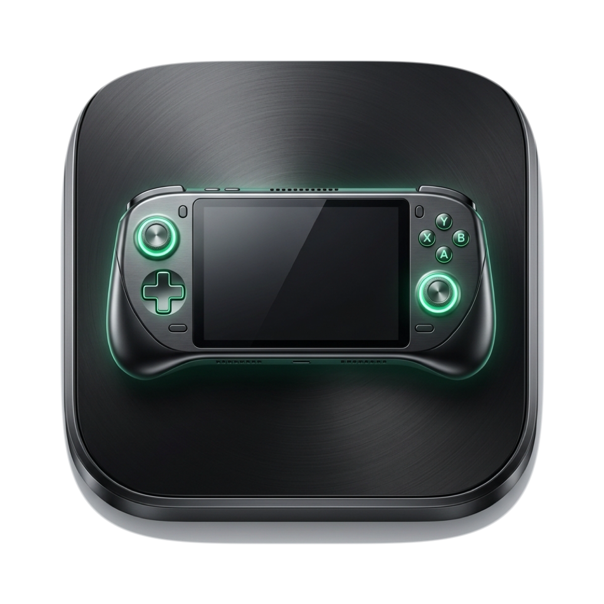
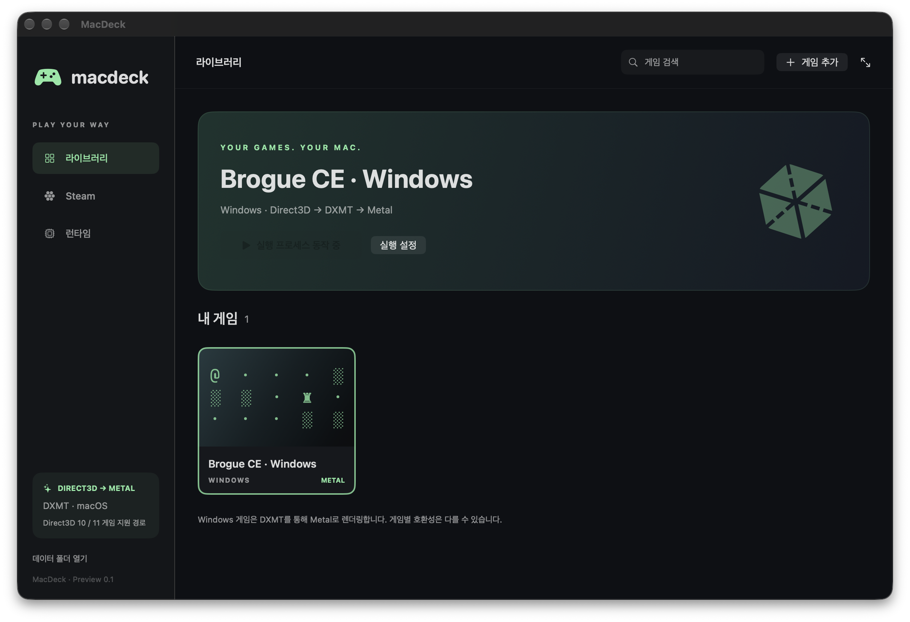
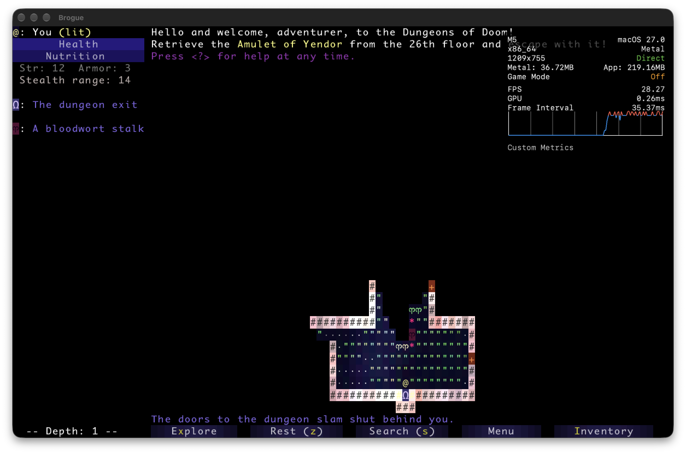

# MacDeck (macDeckAI)

> **Apple Silicon Mac을 위한 Steam 머신 경험 및 Windows 게임 Metal 가속 런처**

MacDeck(macDeckAI)은 Apple Silicon(M-시리즈) Mac 환경에서 Windows 게임과 Windows Steam Big Picture 모드를 네이티브에 가깝게 즐길 수 있도록 돕는 오픈소스 프로젝트입니다.

현재 안정성: **RE3 DX11 non-RT는 영상 후처리 의존성 보완 후 사용자 구동 성공 보고를 받았습니다. 장시간 안정성은 미검증이며 DX12 GPU timeout은 미해결입니다.** Game Mode 지원 키의 실제 설치 반영은 v0.5.4에서 복구했으며, `On` 여부는 macOS 기본 전체화면에서 따로 확인해야 합니다.

---

## 📸 미리보기

| MacDeck 공식 앱 아이콘 | MacDeck 라이브러리 UI | Windows 게임 Metal HUD 구동 (Brogue CE) |
|:---:|---|---|
|  |  |  |

---

## ⚡ 주요 특징

1. **Apple Silicon 네이티브 UI & Steam Big Picture 연동**
   - SwiftUI / AppKit 기반의 깔끔한 macOS 네이티브 인터페이스.
   - 공식 Windows Steam 클라이언트를 백그라운드 환경에 설치하고, Steam Big Picture 모드를 한 번의 클릭 또는 패드 입력으로 실행.
   - Steam 라이브러리(`libraryfolders.vdf`, `appmanifest`)를 자동 파싱하여 MacDeck 런처에 동기화.

2. **Apple Metal 하드웨어 가속 및 전역 DX11 Mode / DX12 Mode 선택**
   - **WineSikarugir 10.0 (x86_64, Rosetta 2)** 기반 호환성 레이어.
   - **전역 그래픽 모드 전환 (모든 게임 공통)**: 상단 툴바, 런타임 설정, 또는 Steam 탭에서 **DX11 Mode**와 **DX12 Mode**를 선택하면 런타임의 DXGI 브리지와 DLL 오버라이드가 전역으로 전환되며, 실행 중인 Steam도 새 모드로 자동 재시작됩니다.
   - **DX11 Mode (DXMT 0.80+ · 기본 권장)**: Direct3D 10/11 호출을 Apple Metal로 직접 변환하며, DX11용 DXGI 브리지를 사용합니다. Steam CEF 호환성을 위해 D3D12 DLL은 비활성화하지 않으며, DX12 전용 게임을 DX11로 변환하는 기능은 아닙니다.
   - **DX12 Mode (VKD3D 1.14 + MoltenVK 1.4.2+ · 실험적)**: Wine D3D12 DXGI 브리지와 MoltenVK(`libvulkan.1.dylib`)를 통해 Direct3D 12를 Apple Metal 3로 가속합니다.
   - **런타임 구성요소 자동 업데이트 (`RuntimeUpdater`)**: `런타임` 설정에서 **MoltenVK**, **DXMT**, **Wine Engine**의 공식 GitHub Releases 최신 버전을 확인하고 SHA-256 무결성 및 `x86_64` 아키텍처 검증 후 원클릭 또는 앱 시작 시 자동으로 업데이트합니다.
   - **macOS Game Mode 지원 정보 & Apple Metal HUD**: `MacDeck.app` 및 내장 `wine` 실행 파일의 `Info.plist`에 `public.app-category.games`, `LSSupportsGameMode`, `GCSupportsGameMode`를 설정하여 전체화면 게임 시 macOS 게임 모드와 Metal HUD를 지원합니다.

3. **외장 SSD/HDD 게임 라이브러리 지원 및 시작 시 자동 연결**
   - 내장 SSD 용량이 부족한 Mac 환경을 위해 외장 저장장치(NVMe/SSD/HDD)의 게임 설치 폴더를 Wine 가상 드라이브(`E:\SteamLibrary` 등)로 매핑.
   - **앱 실행 시 설정된 외장 게임 설치 폴더가 있으면 드라이브 심볼릭 링크와 Steam `libraryfolders.vdf` 등록 상태를 자동으로 연결·복구**.
   - 연결 해제 시에도 외장 드라이브의 실제 게임 파일은 안전하게 보존.

4. **게임패드 완벽 지원 (콘솔 모드)**
   - Apple GameController 프레임워크 및 SDL2 기반 DualShock 4, DualSense, Xbox 등 컨트롤러 인식.
   - MacDeck 런처 UI를 게임패드로 직접 탐색/실행할 수 있는 핸드헬드/콘솔 UX 제공.
   - Windows 내장 XInput 오버라이드 및 `joy.cpl` 진단 도구 연계.

5. **정밀한 3D 게임 크래시 분석 및 진단 시스템 (Diagnostics)**
   - 각 게임 실행마다 고유 UUID 기반 격리 로그 디렉터리 생성.
   - DXMT/렌더러 로그(`Renderer/`)와 프로세스 출력(`process.log`) 분리 저장.
   - GPU 장치 손실(Device Loss), D3D12 어댑터/장치 생성 실패(`IWineDXGIAdapter` / `D3D12CreateDeviceFailed`), 셰이더 컴파일 오류, DLL 예외 패턴을 자동 분석하여 `summary.txt` 단서 제공.
   - 원클릭 **진단 ZIP 내보내기** 기능으로 디버깅과 리포팅 용이.

---

## 🎮 게임 검증 및 호환성 현황

### 🕹️ 2D 게임: 1차 검증 완료 (추가 테스트 확장 진행 중)
- **검증 완료 항목:**
  - Windows x86_64 바이너리인 **Brogue CE 1.15.1**을 Wine + D3D11 + DXMT + Apple Metal 경로로 구동 성공.
  - Apple M5 환경에서 Apple Metal HUD 및 던전 렌더링 정상 확인.
- **향후 계획:**
  - 1차 검증은 완료되었으나, DirectDraw, Direct3D 9, SDL 소프트웨어 렌더러, 레거시 OpenGL 등 다양한 그래픽 엔진을 사용하는 **더 많은 종류의 2D 인디/클래식 게임을 추가 테스트**하여 호환성을 폭넓게 확보할 예정입니다.

### 🎲 3D 게임: 전역 DX11 Mode(DXMT) & DX12 Mode(VKD3D/MoltenVK) 구축 및 집중 테스트 진행 중
- **현재 상태:**
  - **DX11 Mode (DXMT → Metal · 기본 권장)** 및 **DX12 Mode (VKD3D 1.14 → winevulkan → MoltenVK → Metal 3 · 실험적)** 전역 전환 파이프라인이 구축되어 있습니다.
  - 외장 NVMe 드라이브(`E:\SteamLibrary`)에 설치된 **Resident Evil 3 (`re3.exe`)** 실행 시 Apple M5 Metal 3 전체화면(`2704x1756`, `38.45 FPS`) 스왑체인 렌더링을 확인했으며, 안정적인 플레이를 위해 전역 기본값을 **DX11 Mode**로 제공합니다.
- **향후 계획:**
  - 3D 게임은 복잡한 셰이더 연산, 엔진별 DirectX 11/12 특성, 안티치트(Anti-Cheat) 솔루션, 런타임 종속성(Visual C++ 재배포 패키지 등), 장시간 플레이 안정성 등 다양한 변수가 존재하므로 **앞으로도 다양한 3D 타이틀을 대상으로 테스트를 집중적으로 많이 수행해봐야 하는 단계**입니다.
  - 진단 시스템을 활용하여 각 3D 타이틀별 오류 패턴을 분석하고 순차적으로 호환성을 개선해 나갈 계획입니다.

### ☁️ Steam 클라이언트 및 외장 스토리지 연동
- Valve 공식 Windows `SteamSetup.exe`를 통한 설치, 최신 클라이언트 업데이트, Big Picture 로그인 및 외장 NVMe SSD(`E:\SteamLibrary`) 게임 다운로드·설치 검증 완료.
- 앱 재실행 시 설정된 외장 게임 설치 폴더 자동 재연결 및 총 **74개 자체 검증 테스트(`--self-test`) 통과**.

---

## 🏗️ 아키텍처

```text
┌─────────────────────────────────────────────────────────────────┐
│                    MacDeck.app (SwiftUI / AppKit arm64)         │
│  - 라이브러리 관리       - 외장 드라이브 자동 연결 - 게임패드 내비게이션 │
│  - 진단 및 ZIP 내보내기  - 전역 DX11/DX12 모드 전환 - 세션 로깅         │
└─────────────────────────────────┬───────────────────────────────┘
                                  │ 실행 (LaunchPlan)
                                  ▼
┌─────────────────────────────────────────────────────────────────┐
│               Rosetta 2 + WineSikarugir 10.0-8 (x86_64)         │
│  - Windows 환경 에뮬레이션 (drive_c, dosdevices)                  │
│  - Windows Steam (Big Picture) & Windows Game .exe              │
│  - Builtin XInput 게임패드 지원 / macOS Game Mode 활성화          │
└──────────────────┬──────────────────────────────┬───────────────┘
   DX11 Mode (기본) │                              │ DX12 Mode (선택)
                   ▼                              ▼
┌──────────────────────────────────┐ ┌────────────────────────────┐
│  DXMT 0.80 (SetRotation 패치)    │ │ Wine D3D12 (VKD3D 1.14)    │
│  - D3D10/11 → Metal 직접 변환     │ │ + Wine DXGI D3D12 Bridge   │
│  - d3d12/d3d12core 비활성화       │ │ + MoltenVK 1.4.1 (Vulkan)  │
└──────────────────┬───────────────┘ └────────────┬───────────────┘
                   └──────────────┬───────────────┘
                                  │ Metal 커맨드 인코딩
                                  ▼
┌─────────────────────────────────────────────────────────────────┐
│                     Apple Metal (Apple Silicon GPU)             │
│  - M-Series GPU 하드웨어 가속 (Metal 3)                          │
│  - Metal Performance HUD 실시간 오버레이                          │
└─────────────────────────────────────────────────────────────────┘
```

---

## 🚀 빠른 시작

### 요구 사양
- Apple Silicon Mac (M1, M2, M3, M4, M5 등)
- macOS 13 (Ventura) 이상 (macOS 15/26+ 지원)
- Rosetta 2 (`softwareupdate --install-rosetta --agree-to-license`)
- Swift 5.9+ 명령행 도구 및 Python 3

### 빌드 및 패키징

```bash
# 1. 저장소 클론
git clone https://github.com/sjhdeux0114/macDeckAI.git
cd macDeckAI

# 2. 런타임 준비, 앱 빌드, 자체 테스트 및 패키징 일괄 실행
bash scripts/package-mac-app.sh

# 3. 앱 실행
open dist/MacDeck.app
```

> **단독 빌드만 수행할 경우:**
> ```bash
> bash scripts/build-mac-app.sh
> dist/MacDeck.app/Contents/MacOS/MacDeck --self-test
> ```

---

## 📁 디렉터리 구조

```text
macDeckAI/
├── Sources/
│   ├── MacDeck/               # MacDeck 메인 애플리케이션 (SwiftUI/AppKit)
│   │   ├── App.swift          # 앱 엔트리포인트 및 UI 뷰
│   │   ├── RuntimeUpdater.swift # MoltenVK / DXMT / Wine Engine 자동 업데이트
│   │   ├── Library.swift      # 게임 라이브러리 및 실행 플랜
│   │   ├── Runtime.swift      # Wine/Steam 프로세스 제어
│   │   ├── SteamClient.swift  # Steam 연동 및 VDF 파서
│   │   ├── SteamStorage.swift # 외장 드라이브 Steam 라이브러리 등록/해제
│   │   ├── ExternalLibrary.swift # 외장 폴더 마운트 관리
│   │   ├── Gamepads.swift     # 게임패드 입력 및 UI 내비게이션
│   │   ├── Diagnostics.swift  # 세션별 로그 및 크래시 진단
│   │   └── SelfTests.swift    # 자체 검증 테스트 스위트
│   └── MacDeckProbe/          # 초기 가상화/Metal 프로브 도구
├── scripts/                   # 빌드, 패키징, 런타임 준비, 호환성 패치 스크립트
├── patches/                   # DXMT 0.80 소스 호환성 패치 파일
├── docs/                      # 기술 문서 및 심층 분석 보고서
│   ├── MACOS-APP.ko.md        # macOS 앱 동작 원리 및 검증 기록
│   └── PORTING-REPORT.ko.md   # DroidDeck 분석 및 Linux VM 비교 리포트
├── licenses/                  # 오픈소스 라이선스 고지
├── work.md                    # 누적 개발/검증/인계 일지
└── AGENTS.md                  # 작업 가이드라인 및 보안 수칙
```

---

## 🔒 보안 및 개인정보 보호

- Steam 계정 비밀번호, Steam Guard 코드, 로그인 세션 토큰 등 인증 정보는 **Steam 공식 클라이언트 내부에서만 처리**되며, MacDeck은 이를 절대 수집하거나 가로채지 않습니다.
- 크래시 진단 로그 및 ZIP 내보내기 시 민감한 환경 변수나 인증 관련 인수는 자동으로 마스킹 처리됩니다.
- 인증 정보 파일 및 일시적 QR 코드 스크린샷은 `.gitignore`에 의해 저장소 추적에서 철저히 격리됩니다.

---

## 📋 변경 내역 (Changelog)

> 세부적인 작업·검증·디버깅 누적 기록은 [`work.md`](work.md)에서 확인할 수 있습니다.

### v0.5.5 (2026-10-18)
- **게임 내 Apple Metal Performance HUD 기본 활성화 및 인게임 단축키 (`Fn + Shift + F9`) 지원**:
  - 기존에는 `showMetalHUD`가 비활성화되어 `MTL_HUD_ENABLED="0"`이 명시적으로 주입됨에 따라 macOS Metal 프레임워크가 HUD 오버레이 자체를 로드하지 않아 게임 중 `Fn + Shift + F9`를 눌러도 HUD가 나타나지 않았습니다.
  - Metal HUD 기본값을 켬(`MTL_HUD_ENABLED="1"`)으로 변경하고 전역 defaults(`MetalForceHudEnabled=YES`) 및 세션 환경을 동기화하여, 게임 화면에서 실시간으로 **`Fn + Shift + F9`**(또는 `Shift + F9`)를 눌러 FPS·GPU 사용률·프레임 간격 오버레이를 자유롭게 켜고 끌 수 있도록 개선했습니다. (`Fn + Shift + F7`로 화면 표시 위치 순환 가능)
- **창 닫기 및 앱 종료 시 완전 종료 (`applicationShouldTerminateAfterLastWindowClosed` & `terminateAll`)**:
  - SwiftUI WindowGroup에서 창 닫기 버튼(빨간색 X 버튼)을 누르면 앱이 종료되지 않고 백그라운드에 남아있던 문제를 해결하기 위해 `MacDeckAppDelegate`를 구현하여 창이 닫히면 앱이 즉시 완전 종료되도록 처리했습니다.
  - 앱 종료(`Cmd + Q`, 창 닫기, 사이드바 "MacDeck 종료" 버튼) 시 `DeckModel.terminateAll()`을 호출하여 실행 중인 자식 프로세스, 로그 핸들, 타이머뿐만 아니라 Wine 백그라운드 데몬(`winedevice.exe`, `steamservice.exe`, `wineserver`)까지 안전하고 완벽하게 정리하여 백그라운드 자원 점유를 방지했습니다.
- **CrossOver / Proton / Whisky 호환 렉·오디오·비디오 최적화 패치 일괄 적용**:
  - Mach-message 기반 초고속 멀티스레드 동기화(`WINEMSYNC=1`, `WINEESYNC=1`, `WINE_LARGE_ADDRESS_AWARE=1`)로 CPU 스레드 병목 및 렉 해소.
  - XAudio2/X3DAudio/DirectSound Wine 내장 오버라이드로 컷씬 대사 누락 및 무음 방지.
  - Apple VideoToolbox 하드웨어 가속(`vtdec`, `vtdec_hw`), AC-3, DTS, MP4/MKV GStreamer 확장 패키지 번들링 및 1.3MB 사전 인덱싱 레지스트리 자동 시딩으로 초기 로딩 프리징 제거.
  - DX11 DXMT 맵 플래그/Alt-Tab 크래시 방지(`DXMT_CONFIG`), DX12 MoltenVK Argument Buffers 및 커맨드 버퍼 사전 채움 최적화 적용.
- **배포용 DMG 패키징 및 GitHub Releases 배포**:
  - `dist/MacDeck-v0.5.5.dmg` 고압축 UDZO 배포 이미지(532MB) 생성 및 GitHub Releases `v0.5.5` 배포 완료. 자체 검증 테스트 **92개 전원 통과**.

### v0.5.3 (2026-10-18)
- **`steamwebhelper.exe` `0x80000003` (`DelayLoadFailureHook`) 크래시 및 `winedbg` 모달/콘솔 팝업 근본 수정**:
  - **원인 규명**: `libcef.dll`의 RVA `0x59ef905`(Chromium `DelayLoadFailureHook`)에서 지연 로드 대상(`dxgi.dll`, `d3d12.dll`) 로드 실패 시 즉시 `int3`(`0x80000003`) 예외가 발생하는 것을 확인했습니다. `Bottles/Steam/drive_c/windows/system32/dxgi.dll` 누락 및 `d3d12,d3d12core=` 비활성화 오버라이드가 결합되어 `steamwebhelper.exe`가 충돌하고, Wine `winedbg --auto`가 모달 에러 창 또는 콘솔 창을 반복 실행하며 공유 메모리(`SteamChrome_MasterStream`)를 잠그던 문제를 해결했습니다.
  - **Prefix `system32` / `syswow64` 자동 동기화 (`DirectX12Support.syncPrefix`)**: 전역 그래픽 모드 적용 시 런타임뿐만 아니라 모든 Wine prefix(`Bottles/*`) 내부의 `drive_c/windows/system32/dxgi.dll` 및 `drive_c/windows/syswow64/dxgi.dll`, 코어 그래픽 DLL(`d3d11.dll`, `d3d10core.dll`, `d3d12.dll`, `d3d12core.dll`, `winemetal.dll`), `AeDebug` 레지스트리를 자동 복구·동기화합니다.
  - **CEF 호환 DLL 오버라이드 및 `winedbg.exe=d` 적용**: `d3d11,dxgi,d3d10core,d3d12,d3d12core,vulkan-1,winevulkan,winemetal=b`를 유지하여 CEF 지연 로드가 실패하지 않게 하면서 DXMT `dxgi.dll`과 `.ini` 설정으로 DX11 경로를 유도하고, `winedbg.exe=d`로 불필요한 크래시 모달/터미널 창 팝업을 차단했습니다.
  - **Steam 종료 시 잔존 프로세스 정리 (`wineserver -k`) 및 기동 경합 방지**: 그래픽 모드 전환이나 런타임 업데이트 시 Steam을 먼저 정상 종료하고 `wineserver -k`로 잔존 프로세스를 정리한 뒤 파일을 교체하도록 개선했습니다.

### v0.5.2 (2026-10-18)
- **런타임 구성요소(MoltenVK · DXMT · Wine Engine) 확인 및 자동 업데이트 (`RuntimeUpdater.swift`)**:
  - `런타임` 설정 탭에 **런타임 구성요소 자동 업데이트** 패널을 추가하여 **MoltenVK**(`KhronosGroup/MoltenVK`, `v1.4.1` → `v1.4.2`), **DXMT**(`3Shain/dxmt`, `v0.80`), **Wine Engine**(`Sikarugir-App/Engines`, `v10.0_8`)의 공식 GitHub Releases 최신 버전을 실시간으로 확인하고 업데이트할 수 있습니다.
  - **앱 시작 시 자동 확인 및 설치** 토글(기본 켜짐), 개별 업데이트 버튼, "업데이트 확인" 및 "지금 자동 업데이트 실행" 버튼을 제공합니다.
  - 다운로드된 패키지의 **SHA-256 무결성 검증**, Mach-O `x86_64` 아키텍처 슬라이스 검증, 기존 파일 백업 후 원자적 교체, 심볼릭 링크(`libvulkan.1.dylib`) 및 호환성 패치(`SetRotation(IDENTITY)`, `dxgi-dxmt`/`dxgi-d3d12`, `wine` Game Mode `Info.plist`) 유지, ad-hoc 코드 재서명을 자동으로 수행합니다.
- **자체 검증 테스트 확대**:
  - `RuntimeUpdater` 버전 비교, GitHub Releases JSON 파싱, SHA-256 검증 및 로컬 아카이브 설치 테스트를 포함해 **74개 자체 검증 테스트(`--self-test`) 전수 통과**.

### v0.5.1 (2026-10-18)
- **전역 DX11 Mode / DX12 Mode 전환 설정 지원**:
  - 특정 게임에만 국한되지 않고 **Steam 및 모든 Windows 게임에 전역으로 적용**되는 `DX11 Mode (DXMT → Metal · 기본 권장)` / `DX12 Mode (VKD3D · MoltenVK → Metal · 실험적)` 전환 기능을 추가했습니다.
  - 상단 툴바 세그먼트 버튼, `런타임` 탭, `Steam` 탭, 게임 실행 설정에서 언제든 모드를 변경할 수 있으며, 모드 전환 시 런타임의 `dxgi.dll`(`dxgi-dxmt` ↔ `dxgi-d3d12`), `WINEDLLOVERRIDES`(`DX11 Mode` 시 `d3d12,d3d12core=` 비활성화), 게임 `.ini` 설정이 일괄 동기화되고 실행 중인 Steam이 자동으로 재시작됩니다.
- **macOS Game Mode (`Game Mode: On`) 활성화**:
  - `MacDeck.app/Contents/Info.plist` 및 내장 `Runtime/bin/wine` 바이너리의 `__TEXT,__info_plist` 섹션에서 `LSUIElement=1`을 제거하고 `LSApplicationCategoryType = public.app-category.games`, `LSSupportsGameMode = true`, `GCSupportsGameMode = true`를 패치하여 macOS `gamepolicyd`가 게임 모드를 활성화하도록 개선했습니다.
- **자체 검증 테스트 확대**:
  - 전역 DX11/DX12 모드 전환 및 런타임/설정 동기화 검사를 포함해 **69개 자체 검증 테스트(`--self-test`) 전수 통과**.

### v0.5.0 (2026-10-18)
- **DirectX 12 (`VKD3D 1.14 + MoltenVK 1.4.1 → Apple Metal 3`) 지원 추가**:
  - `Runtime/lib/libvulkan.1.dylib` 및 `libvulkan.dylib` → `libMoltenVK.dylib` 심볼릭 링크 구성.
  - DXMT `dxgi.dll`(D3D10/11 전용)과 Wine `d3d12.dll`(`IID_IWineDXGIAdapter` / `ID3D12CommandQueue` 요구) 간의 인터페이스 충돌을 해결하기 위해 Wine 원본 D3D12 호환 `dxgi.dll`(237KB, `Wine native  DLL` 브리지)을 `Runtime/lib/wine/dxgi-d3d12/`에 별도 보존.
  - `DirectX12Support` 자동 감지(`D3D12Core.dll`, `d3d12.dll`, `.ini` `Capability=DirectX12`, 실행 파일 `D3D12CreateDevice` 임포트 검사) 및 게임별 그래픽 백엔드(`자동 감지` / `DXMT` / `D3D12`) 선택 UI 추가.
  - 외장 NVMe 드라이브에 설치된 3D Steam 게임 **Resident Evil 3 (`re3.exe`, DirectX 12)** 실행 및 Apple M5 Metal 3 스왑체인 렌더링 검증.
- **앱 시작 시 외장 게임 설치 폴더 자동 연결 (`autoConnectAll`)**:
  - `library.json`에 설정된 외장 게임 설치 폴더(`externalLibraries`)가 있으면 앱 실행 시 자동으로 Wine `dosdevices/<drive>:` 심볼릭 링크를 생성·복구하고 비루트 경로(`E:\SteamLibrary`) 마이그레이션 및 Steam `libraryfolders.vdf` 등록을 수행.
- **진단 및 테스트 강화**:
  - `SessionDiagnostics`에 D3D12 어댑터/장치 생성 실패(`17399d75-964e-4c03-99f8-9d4fd196dd62`, `D3D12CreateDeviceFailed`) 단서 요약 추가.
  - 자체 검증 테스트(`--self-test`) **54개 → 68개**로 확대 및 전수 통과.

### v0.4.0 – v0.4.1 (2026-10-17)
- **외장 스토리지 Steam 자동 등록 및 비루트 경로(`E:\SteamLibrary`) 정규화**:
  - Steam 실행 여부를 `tasklist.exe`로 확인 후 안전하게 종료하고 `steamapps/libraryfolders.vdf` 및 `config/libraryfolders.vdf` 양쪽에 백업 후 반영.
  - 연결 해제 시 실제 게임 파일은 삭제하지 않고 보존하는 안전 해제 구현.
- **게임패드(DualShock 4 등) 지원 및 런처 콘솔 내비게이션**:
  - Apple `GameController` 및 SDL2 기반 실시간 버튼·스틱·트리거 입력 모니터링, 전경 런처 패드 조작, Windows builtin XInput 오버라이드 적용.
- **실행별 정밀 진단 시스템 (`Diagnostics.swift`)**:
  - 실행별 독립 세션 폴더, `diagnostics.json`, 렌더러 로그 분리(`Renderer/`), 오류 단서 요약(`summary.txt`), 원클릭 진단 ZIP 내보내기 구현.

### v0.2.0 – v0.3.0 (2026-10-17)
- **Windows Steam Big Picture 통합 (`WineSikarugir 10.0_8`)**:
  - Valve 공식 `SteamSetup.exe` 무인 설치, 전용 영속 prefix(`Bottles/Steam`), Big Picture 자동 시작, 설치된 Steam 게임 자동 동기화.
- **외장 드라이브 연결 기반 마련 (`ExternalLibrary.swift`)**:
  - 외장 볼륨 UUID 마커 파일 기반 연결 상태 확인 및 Wine 드라이브 문자 할당.

### v0.1.0 (2026-10-17)
- **macOS 네이티브 런처 및 Direct3D 11 → DXMT 0.80 → Apple Metal 가속**:
  - `SetRotation(IDENTITY)` 호환 패치를 통해 SDL2/D3D11 게임의 OpenGL 폴백을 방지하고 Apple M5 Metal HUD 및 **Brogue CE (Windows x86_64)** 하드웨어 가속 검증 완료.

---

## 📄 라이선스

본 프로젝트의 자체 소스 코드는 **GPL-3.0** 라이선스로 배포됩니다.
포함되거나 연계되는 외부 런타임(Wine, DXMT, VKD3D, MoltenVK, SDL2 등)은 각 프로젝트의 원본 라이선스를 준수합니다. 자세한 내용은 [`LICENSE`](LICENSE) 및 [`licenses/`](licenses/) 디렉터리를 참고하십시오.


### 진행 중 — RE3 플레이 안정성 및 Game Mode 실제 적용 (2026-10-18)
- RE3 타이틀/프레임 렌더링 확인과 새 게임 이후의 안정적 플레이는 구분합니다. 사용자가 새 게임/플레이 중 크래시를 보고하여 재현·로그 수집 중입니다.
- 설치된 Wine에 Game Mode plist 키가 반영되지 않는 고정 길이 패치 문제를 확인하고 간결한 XML로 수정했습니다. 실제 On 여부는 전체화면 실행 후 별도로 검증합니다.


### v0.5.4 (2026-10-18)
- Wine의 936-byte embedded plist에 맞지 않아 Game Mode 지원 정보가 누락되는 문제를 compact XML로 수정. 바이너리 길이 및 Wine application class를 보존하고 실제 설치본에도 반영했습니다.
- Game Mode는 [Apple의 전체화면 활성화 조건](https://support.apple.com/en-mide/105118)을 따릅니다. 지원 키 반영과 실제 On을 구분하며 On을 확인했다고 주장하지 않습니다.
- Steam raw 출력/인증 정보는 저장하지 않고 Vulkan/MoltenVK 오류만 허용 목록으로 남기는 별도 수집기와 `Renderer/vulkan-stderr.log`를 추가했습니다. 진단 요약에 Vulkan 장치 손실 단서를 추가했습니다.
- DX11 모드가 DX12 전용 게임을 변환한다는 설명을 정정했습니다. RE3 새 게임/플레이 중 크래시는 재현·조사 중이며 미해결입니다.
- 자체 검사 **77개** 및 그래픽 로그 필터 검사 **3개** 통과. 설치본 v0.5.4 서명 검증 완료.

### 2026-10-18 — RE3 검은 화면 조사
- 반복 Metal GPU timeout 후 VK_ERROR_DEVICE_LOST를 확보했습니다. 근본 원인은 조사 중이며 안정적인 플레이는 아직 검증되지 않았습니다.
- GPU 오류 후 강제 재개 설정을 해제하고 진단 요약에 Metal timeout을 추가했습니다. timeout 자체의 해결은 아니며 다음 실행부터 적용됩니다. Game Mode는 여전히 Off로 보고됐습니다.
- 이번 수정 후 빌드 및 자체 검사 **79개 통과**. DX11 버전 비교와 실제 플레이 검증은 남아 있습니다.
- 설치본 실행 파일 교체 및 서명 검증 완료. 적용을 위한 Steam 재시작 및 게임 재검증은 아직 진행하지 않았습니다.

- 2026-10-18: 사용자 Steam에서 RE3 `dx11_non-rt` 제공 확인. 해당 게임 버전 다운로드 후 MacDeck DX11 Mode(DXMT → Metal)로 비교 예정이며, DX11 안정성은 아직 미검증입니다.

### 2026-10-18 — DX11 비교 결과
- RE3 dx11_non-rt(build11047294), DX11 Mode에서도 새 게임 시작 시 접근 위반(0xC0000005)으로 종료. 안정적 플레이 미달이며 DX12 GPU timeout과 동일 원인인지는 미확인입니다.
- 선택적 예외 진단 MACDECK_TRACE_EXCEPTIONS=1과 허용 목록 예외 주소 수집을 추가했습니다. 영상 재생 경로도 조사 후보이나 원인으로 확정하지 않았습니다.
- 예외 진단 빌드 자체 검사79개 및 예외 로그 필터 검증 통과. 다음 실행의 예외 주소를 확보해 원인 모듈을 조사합니다.
- 영상 런타임 결함 발견: winegstreamer.so의 GStreamer 의존 라이브러리 누락으로 실제 로드 실패. RE3 크래시와의 인과관계는 아직 미확인입니다.

### 2026-10-18 — 영상 의존성·한글 글꼴 보완
- 공식 GStreamer1.28.8을 앱 전용 Runtime/Media에 배치. x86_64 Wine 영상 모듈 로드와 WMV3 디코더 검사 통과. 시스템 설치는 하지 않으며 실제 RE3 플레이 재검증은 남아 있습니다.
- Steam 한글 네모 대응: 이 Mac의 기존 Apple SD Gothic Neo를 Wine에 연결하고 한국어 대체 글꼴/FontLink 자동 등록. Apple 글꼴은 배포물에 포함하지 않습니다. 실제 화면 검증은 남아 있습니다.
- 빌드 및 자체 검사79개 통과.
- 한글 등록 첫 실행의 라이브러리 검색 경로 누락을 수정했습니다. regedit 성공 및 FontLink/한국어 대체 글꼴 레지스트리 반영 확인, 재빌드/검사79개 통과.
- 수정 설치본에서 한글 등록 성공 마커 및 새 Steam 세션 running 확인. 실제 한글 화면 표시와 RE3 새 게임 진행은 사용자 확인 대기 중입니다.

- 디코더 보완 후에도 RE3가 동일 주소에서 종료됨. WMV 디코더 외에 누락된 ASF 컨테이너 파서를 추가하고 영상 생성 실패 진단을 보강 중입니다. 실제 플레이 해결은 아직 확인되지 않았습니다.
- ASF 파서 인식뿐 아니라 합성 WMV/ASF 생성→파싱→디코드 파이프라인까지 x86_64에서 통과했습니다. 앱 설치본에 보완 반영 후 DX11 Steam을 재시작했습니다. RE3 자체의 플레이는 재검증이 필요합니다.

- 최신 RE3 로그에서 deinterlace 요소 누락→영상 소스 생성 실패→같은 주소 접근 위반을 확인했습니다. effects 패키지 및 Wine 후처리 체인 검증 스크립트를 추가했습니다. RE3의 실제 진행은 재검증이 남아 있습니다.
- deinterlace 포함 필수 요소12종과 영상/음성 처리2종 검사 모두 통과. 보완 런타임 설치 및 DX11 Steam 재시작 완료. RE3 플레이 성공은 아직 미확인입니다.

- 2026-10-18: deinterlace 보완 후 사용자 RE3 구동 성공 보고. 장시간 안정성은 미검증. Game Mode는 여전히 Off이며 Metal HUD 표시 상태와 별개입니다.

### 2026-10-18 — Steam Big Picture 화면 가속 설정
- 기존 고정 GPU 비활성화 옵션을 선택 가능하게 변경했습니다. Steam 탭의 화면 GPU 가속 토글로 허용하며 완전 재시작 후 적용됩니다. 게임 Metal 가속과 별개입니다. 검은 화면/호환 문제가 생기면 끄고 다시 실행할 수 있습니다. 실제 가속 및 성능은 검증 중입니다.
- 화면 가속 옵션 검사 포함 자체검사80개 통과, 설치본에 반영하고 가속 허용으로 Steam 재시작. 실제 GPU 렌더링 검증 중입니다.
- 실제 재시작 후에도 Steam 자체가 --disable-gpu/SwiftShader를 선택해 Big Picture mode:System 유지. Steam 내부 웹 보기 GPU 가속 설정 확인이 필요하며, 현재 성능 개선 성공은 미확인입니다.

- Steam 내부 가속 설정이 이미 켜졌는데도 소프트웨어 렌더링이 유지됨을 사용자 확인. 가속 모드에 명시적 -cef-force-gpu를 추가해 비교 검증 중입니다.

- GPU 비교 중 구형 진단 도구가 새 설정 필드를 버려 소프트웨어 모드로 복귀한 문제를 발견했습니다. 설정을 복구해 다시 비교 중이며 앞선 재시작을 가속 성공으로 간주하지 않습니다.
- 개발용 ad-hoc 서명은 cdhash 기반으로 권한 유지에 제약이 있습니다. 외장 저장소 허용 반복을 조사 중입니다.

- Steam GPU investigation: Wine kernelbase injects --disable-gpu for Steam. A reversible exact-match patch is under runtime validation. Performance improvement remains unverified. External access was retained on the latest restart, but development resigning can trigger another permission request.

- Confirmed MacDeck removable-volume consent prompt recurs after ad-hoc resigning. Cross-update permission persistence remains unresolved; same-build consent and stable certificate signing must be distinguished.

### 2026-10-18 — HUD default off / DMC5 investigation
- User reports Steam Big Picture now works well.
- Metal HUD is now off by default, with an optional runtime settings toggle. Restart Steam and games to apply; Metal acceleration and error logs remain enabled.
- DMC5 has confirmed Metal GPU timeout followed by rejected submissions; long-stall stability and Command-Tab recovery remain unresolved.
- HUD-off build: 82 self-checks passed; installed and Steam restarted. Steam GPU configuration preserved. New session HUD environment: 0.

- Repeated removable-volume consent remains under investigation. The HUD build changed ad-hoc identity again; current installed signature verifies successfully. Further resigning is paused during same-build permission reproduction.
- User clarified consent repeats after updated builds. This matches changing ad-hoc signing identity; same-run repeated consent has not been reported. Stable certificate signing remains pending.

- DMC5 still freezes in windowed/60 per user. Latest renderer log is empty; prior GPU timeout is not sufficient to identify this new freeze. Added a DMC5-only DXMT60 FPS limiter and Wine Alt-Tab handling comparison config, without resigning MacDeck. Actual gameplay remains unresolved.

- DMC5 live recurring stalls sampled: Metal completion wait plus ongoing command encoding. Prepared an uninstalled GS/TS marshal arithmetic candidate patch. Actual Metal compiler component is missing; official Xcode component download started. No stall fix has been validated.
- Candidate GS/TS fix compiled after official Metal toolchain installation; native Metal tests match36 functions and pass a zero-draw/multi-task GS test. Binary deployment is pending size compatibility and actual DMC5 replay.

### 2026-10-18 — Experimental DMC5 stall candidate
- Installed a source-based DXMT0.80 GS/TS marshal candidate after native Metal boundary/batch validation and PE structural checks. Exact-version guard and original DLL backups retained.
- This is a runtime experiment; DMC5 same-scene stall resolution is not yet verified. Big Picture workaround and HUD-off remain enabled. New signing may request external-volume access again.

### 2026-10-18 — 사용자 확인 결과
- **DMC5: GS/TS 수정 후보 적용 후 긴 렉이 없어졌다는 사용자 확인을 받았습니다.** 장시간·전체 장면 안정성은 아직 미검증입니다.
- RE3 DX11 non-RT 구동, Steam Big Picture 정상화도 사용자 보고로 확인했습니다. HUD는 기본 끔입니다.
- 앱 자체 검사88개, 미디어 필수 요소/처리 체인23항목, 실제 Metal GS·TS 경계/복수 작업 검사를 통과했습니다. Game Mode On, DX12 안정성 및 수정본마다 반복되는 외장 볼륨 권한은 여전히 별도 과제입니다.
- Runtime binary patches are experimental and version-locked. See [runtime patch notes](docs/runtime-patches.md) for reproducibility and rollback.

### 2026-10-18 — 타 플랫폼(Proton/CrossOver/Whisky/DXMT) 종합 최적화 (v0.5.5)
- **멀티스레드 동기화 최적화 (MSync / ESync)**:
  - macOS Mach-message 및 공유 메모리 기반 고속 동기화인 `WINEMSYNC=1`, `WINEESYNC=1`, `WINEMSYNC_QLIMIT=512`를 활성화하여 wineserver 소켓 IPC 병목에 의한 CPU 렉과 스레드 기아 현상을 해소.
  - 32비트/구형 게임의 2GB 가상 메모리 초과 크래시를 방지하는 `WINE_LARGE_ADDRESS_AWARE=1` 활성화.
- **오디오 끊김 및 컷씬 무음 방지 (XAudio2 / DirectSound)**:
  - RE Engine 및 Unreal Engine 게임들이 번들하는 Windows용 불완전 DLL 로드를 방지하고 Wine 내장 FAudio/CoreAudio를 강제 적용하도록 `xaudio2_0`~`xaudio2_9`, `x3daudio1_0`~`x3daudio1_7`, `dsound`를 `WINEDLLOVERRIDES`에 내장(`b`)으로 등록.
- **동영상 컷씬 하드웨어 가속 및 코덱 보강 (Media Foundation / GStreamer)**:
  - Apple Silicon VideoToolbox 하드웨어 가속 디코더(`vtdec`, `vtdec_hw`), Dolby Digital AC-3(`a52dec`), DTS(`dtsdec`), MP4(`qtdemux`), MKV(`matroskademux`) 등 GStreamer 확장 패키지 번들링.
  - 호스트 GStreamer 플러그인 충돌을 차단하는 격리 환경변수(`GST_PLUGIN_PATH_1_0=""`) 및 `mfplat`, `mfreadwrite`, `quartz` 내장 오버라이드 등록.
  - 미디어 런타임 검사 스크립트 23개 항목(`verify-media-runtime.py`) 전원 통과.
- **렌더링 프레임 페이싱 및 크래시 방지 (DXMT & MoltenVK)**:
  - DX11 (DXMT): `d3d11.ignoreMapFlagNoWait=True` (비동기 Map 크래시 방지), `dxgi.handleAltTab=True` (전체화면 전환 프리징 방지), `d3d11.maxTessFactor=64` (테셀레이션 폭주 방지) 기본 적용.
  - DX12 (MoltenVK + VKD3D): `MVK_CONFIG_USE_METAL_ARGUMENT_BUFFERS=1` (드로우콜 오버헤드 감소), `MVK_CONFIG_PREFILL_METAL_COMMAND_BUFFERS=3` (커맨드 지연 완화), `VKD3D_FEATURE_LEVEL=12_1`, `VKD3D_CONFIG=no_upload_hlist` 적용.
- **초기 로딩 프리징 방지 및 Prefix 그래픽 DLL 동기화 보강**:
  - `Runtime/Media/gst-registry.bin` 사전 캐시 번들링 및 자동 시딩을 통해 최초 게임 구동 시 10~15초 플러그인 전수조사 프리징을 완전히 제거.
  - Prefix(`drive_c/windows/{system32,syswow64}`) 내부 그래픽 DLL(`d3d11.dll` 등)을 바이트 단위로 검사하여 런타임 최신 패치 버전을 원자적으로 강제 동기화.
- **배포용 DMG 패키징 (`scripts/package-dmg.sh`)**:
  - `/Applications` 심볼릭 링크를 포함한 드래그 앤 드롭 설치 디스크 이미지(`MacDeck-v0.5.5.dmg`, 537MB) 생성 및 GitHub Releases 배포 지원.
- **창 닫기 시 백그라운드 프로세스 즉시 완전 종료**:
  - 메인 창 닫기 시 Wine/Steam 및 자식 프로세스가 백그라운드에 남아있던 현상을 수정하여 `applicationShouldTerminateAfterLastWindowClosed = true` 및 `terminateAll()`(wineserver 강제 정리)을 통해 즉각 완전히 종료되도록 개선.
- **Metal Performance HUD 실시간 단축키 (`Fn+Shift+F9`) 및 기본 활성화**:
  - 게임 플레이 중 GPU 프레임률, 프레임타임, 메모리 사용량을 즉시 확인할 수 있도록 `MTL_HUD_ENABLED=1` 기본 활성화 및 `Fn+Shift+F9`(또는 `Shift+F9`) 실시간 온오프 토글, `Fn+Shift+F7` HUD 위치 이동 안내 UI 추가.
- **MacDeck 전용 3D Apple-스타일 공식 앱 아이콘 (`AppIcon.icns`) 도입**:
  - Apple macOS 정밀 스퀴클(Superellipse) 규격을 준수한 고해상도(16×16 ~ 1024×1024) 전용 아이콘 제작 및 번들 탑재.
  - macOS Dock, Launchpad, Cmd+Tab 앱 전환기 및 MacDeck 사이드바에 통일된 아이콘 브랜딩 적용.
- **DirectX 9 (D3D9) 및 고전 게임 호환성 안정화**:
  - 30초전사(Half Minute Hero) 등 32비트 DirectX 9 게임 구동 시 범용 DXVK의 macOS 미지원 확장 오류(`D3DDevice creation failed`) 및 미완성 Vulkan 백엔드의 메모리 경합 크래시(`0xC0000005`)를 완벽히 해결. 공식 검증 WineD3D 및 Mach-message MSync 파이프라인으로 안전 구동.
  - ProMotion 120Hz 화면에서 60fps 고정 틱 게임의 슬로우모션/버벅임 해소 가이드라인 제공.
- **주요 게임 및 상용 게임 엔진(Unity · Unreal Engine · CryEngine · Frostbite · Cocos2d · Godot) 종합 충돌 방지**:
  - **Unity 엔진**: `UnityCrashHandler32/64.exe` 비활성화로 크래시 핸들러 무한 루프 및 창 프리징 차단.
  - **Unreal Engine 4 & 5 (호그와트 레거시 등)**: `CrashReportClient.exe` 소켓 IPC 블로킹 차단 및 DX12 가상 디스크립터 힙(`VKD3D_CONFIG=virtual_heaps`) 지원으로 대규모 텍스처 메모리 크래시 방지.
  - **CryEngine & EA Frostbite**: 백그라운드 프리징 및 오류 팝업을 유발하는 `CryCrashHandler.exe`, `OriginCrashReporter.exe`, `EACrashReporter.exe` 비활성화.
  - **FromSoftware (엘든링 등)**: `easyanticheat_x64=d`를 통해 Easy Anti-Cheat 커널 드라이버 로드 실패에 의한 초기 시동 크래시 방지.
  - **Rockstar (GTA V 등) & 2D 엔진 (Cocos2d 등)**: DirectInput 8(`dinput8=b`), 런타임 셰이더 컴파일러(`d3dcompiler_43/47=b`), 및 창 포커스 이탈 시 강제 최소화 방지(`SDL_VIDEO_MINIMIZE_ON_FOCUS_LOSS=0`) 적용.
  - **Apple Silicon Metal 특화 DLSS 충돌 방지**: 비호환 NVIDIA 라이브러리 쿼리 충돌(`nvngx=_nvngx=d`)을 차단하여 FSR/XeSS 정상 폴백 유도.
- 자체 검증 테스트 총 **94개 통과** (`94 checks passed`) 및 strict 코드 서명 검증 완료. (로컬 커밋 및 패키징 완료, 원격 GitHub 미업로드).
