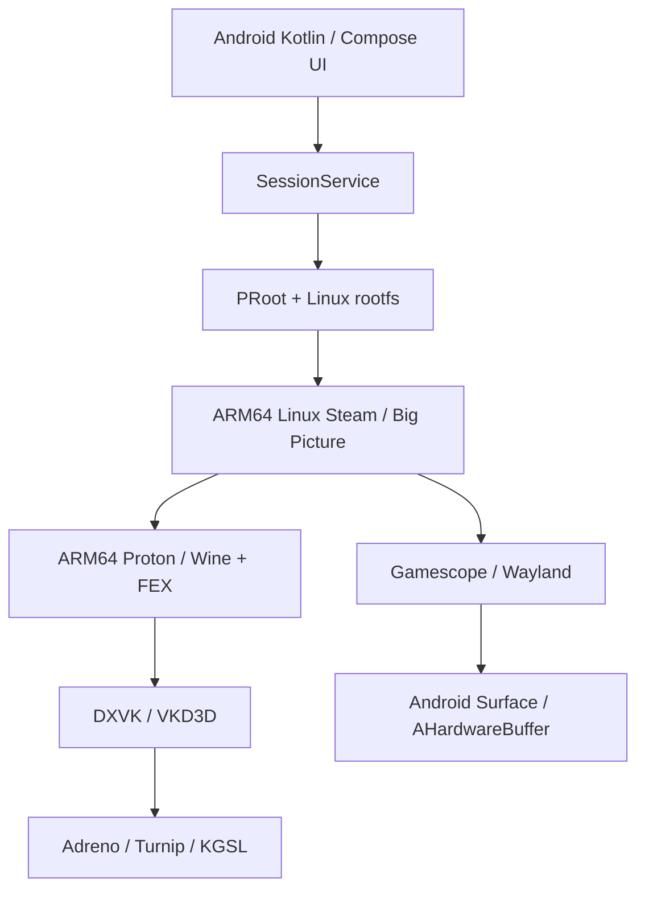

# DroidDeck → macOS / iPadOS 포팅 조사

> 후속 작업: [MacDeck macOS 앱](MACOS-APP.ko.md)에서 Windows Brogue CE를 DXMT→Metal로 실제 실행했습니다. 아래 문서는 첫 단계의 Linux VM 조사 기록입니다.

조사일: 2026-10-17, Asia/Seoul. 기준 커밋: `64d78aa812305d707700e2ad460f3b94d03ed50c`.

## 판단

**Mac용으로 같은 목적의 앱을 만드는 것은 가능성이 높습니다. 하지만 DroidDeck의 Android 실행 백엔드는 대폭 교체해야 합니다.** 이번 작업에서는 실제 Mac에서 Linux VM과 Metal 계산까지 검증했습니다. Steam 로그인이나 Windows 게임 실행까지 완성한 상태는 아닙니다.

**일반 iPadOS에서 같은 로컬 실행 방식을 그대로 옮기는 경로는 확보하지 못했습니다.** CPU가 ARM64라는 공통점만으로 Linux 실행·JIT·그래픽 장벽이 해결되지는 않습니다. 별도 소프트웨어 에뮬레이터나 개발용 JIT 환경을 이용한 연구 가능성까지 부정하는 뜻은 아닙니다.

단기 제품 방향으로는 **macOS용 Wine 실행기를 백엔드로 두고 게임 라이브러리·컨트롤러 중심 UI를 구현**하는 방안이 가장 현실적이라고 판단합니다. 원본 Linux/Proton 구조 유지가 목표라면 Linux VM의 GPU 전달부터 연구해야 합니다. 이 우선순위는 소스와 이번 실험을 토대로 한 공학적 판단이며 게임 호환성 보장은 아닙니다.

## 원래 앱은 어떻게 작동하는가



Valve가 만든 Android용 Steam 앱을 단순히 감싼 구조로 설명하면 부정확합니다. 소스의 설치 스크립트는 Valve CDN의 `steam_client_steamdeck_publicbeta_linuxarm64`를 요청합니다. 공식 Proton 저장소에도 ARM64 빌드가 있습니다. 따라서 관찰한 구조는 **Valve의 ARM64 Linux 구성요소를 Android Linux 환경에 연결한 커뮤니티 앱**입니다. [Steam 설치 코드](https://github.com/Droid-Deck/DroidDeck/blob/64d78aa812305d707700e2ad460f3b94d03ed50c/tools/linuxfs/overlay/usr/local/bin/droiddeck-steam-install), [Valve Proton](https://github.com/ValveSoftware/Proton#arm64-builds).

원본의 추적 파일 1,418개를 목록화했습니다. 그중 Kotlin/Java 파일 289개에서 `import android.`를 확인했습니다. 추적된 원시 ELF 9개는 모두 AArch64였고 `libc.so`, `libdl.so` 등의 의존성이 있었습니다. 이 수치는 압축된 런타임 내부까지 포함한 전체 바이너리 수가 아니며, 포팅 작업량의 백분율로 해석할 수 없습니다. 상세 목록은 `evidence/source-audit.json`에 있습니다.

## 교체하거나 재사용할 부분

| 영역 | 소스 근거 | Apple 플랫폼에서 필요한 일 |
|---|---|---|
| 앱·UI | `app/build.gradle:75`, `:98`, Compose 의존성 | Android Gradle/NDK 앱이므로 SwiftUI/AppKit 등으로 UI와 수명주기 재구현 |
| Linux 프로세스 | `LinuxRuntime.java:31`, `:123` | PRoot 대신 VM 또는 Darwin용 호환 실행기. PRoot는 Linux 커널을 에뮬레이션하지 않음 |
| 세션 조율 | `SessionService.kt:409`, `:455`, `:582` | 실행·환경변수·오디오·종료 관리의 설계 참고. Android Service 자체는 교체 |
| GPU 드라이버 | `LinuxRuntime.java`의 `/dev/kgsl-3d0`, GPU bind | Qualcomm 드라이버를 Apple GPU에 사용할 수 없음. macOS Metal/Vulkan 경로 필요 |
| 화면 출력 | `waylandcomp/src/vk_present.c:650`, `ahb_swapchain.c` | Android Surface·하드웨어 버퍼를 Apple 화면·메모리 모델로 교체 |
| 오디오 | PulseAudio / Android native 라이브러리 | CoreAudio/AVAudioEngine 연결 또는 VM 오디오 장치 설계 |
| 입력 | Android 컨트롤러·BLE·터치 경로 | GameController/HID·터치·포커스·햅틱 재구현 |
| 게임 프로필·스토어 | JSON, VDF, Python 도구, Rust stores | 데이터 모델·프로토콜·일부 알고리즘 재사용 후보. JNI와 파일 시스템 가정 분리 필요 |
| Windows 호환성 | `ComponentsManager.kt`, ARM64 Proton/FEX | Linux용 Proton을 Darwin에서 직접 로드할 수 없음. 백엔드별 별도 런타임 필요 |

위 표의 파일은 고정 커밋의 `upstream/DroidDeck/app/src/main/` 아래입니다. `tools/linuxfs/overlay/usr/local/bin/`의 스크립트도 조사했습니다. Python/Bash라는 이유만으로 macOS에 그대로 이식 가능한 것은 아닙니다. `gamescope`, `/proc`, GNU 도구, Linux 경로와 Android용 preload에 대한 가정을 제거해야 합니다.

Rust stores에는 HTTP·압축·해시·다운로드 로직 등 재사용 후보가 있습니다. 그러나 JNI 모듈이 공개 모듈로 연결돼 있고 플랫폼별 파일 연산도 있습니다. Rust 크레이트의 macOS/iOS 빌드나 인증·다운로드 동작은 검증하지 않았습니다.

## 실제 Mac에서 검증한 결과

실행 장비는 진단 API 기준 Apple M5, 논리 CPU 10개, 메모리 24 GiB, macOS 27.0.1입니다. `evidence/host.json`에 원문을 저장했습니다.

| 검사 | 결과 | 증거와 의미 |
|---|---|---|
| Swift 프로그램 빌드·서명 | 성공 | `evidence/build.log`, virtualization entitlement 포함 |
| Metal GPU 계산 | 성공 | GPU 커널의 256개 결과를 CPU에서 전수 대조 |
| Virtualization 지원 | 확인 | `VZVirtualMachine.isSupported == true` |
| ARM64 Linux 부팅·사용자 프로그램 | 성공 | Linux `6.18.52-0-virt`, `uname -m = aarch64` |
| 페이지 크기 | 확인 | macOS 16,384 bytes, Linux guest 4 kB |
| Linux 가상 디스플레이 | 장치 생성 성공 | virtio GPU, framebuffer, DRM 노드 |
| 게임용 GPU 전달 | 이번 구성에서 확보 못함 | `-virgl`, `-context_init`, cap sets 0 |
| Android `.so` 직접 로드 | 예상대로 실패 | dyld: `slice is not valid mach-o file` |
| 바이너리 도구 회귀 검사 | 6개 성공 | endian/ELF 의존성/커널 추출/손상 입력 검사 |
| FEX·Steam·Proton·Windows 게임 | 미실행 | 이 단계의 성공으로 간주하지 않음 |

처음 샌드박스 안에서는 Metal 장치와 가상화 지원이 보이지 않았습니다. 같은 바이너리를 장치 접근이 허용된 환경에서 실행한 뒤 실제 지원과 계산 성공을 확인했습니다. 따라서 최초 결과를 하드웨어 미지원으로 오판하지 않았습니다.

또한 Alpine의 `vmlinuz-virt`는 gzip 페이로드가 담긴 EFI zboot 형식이어서 그대로 VZLinuxBootLoader에 넘겼을 때 VM 시작에 실패했습니다. 헤더에서 페이로드 위치·길이를 읽어 ARM64 Image를 추출한 뒤 부팅에 성공했습니다. 이 변환은 재현 스크립트와 회귀 검사에 반영했습니다.

부팅 입력은 Alpine 3.24.2 AArch64 virt ISO이며, 공식 릴리스 메타데이터의 SHA-256 `a57ba668b5f6b17a670fcf8e799d5d7fe43766ed086d6ce2927b0625bf43dbf6`과 대조했습니다. [공식 다운로드 경로](https://dl-cdn.alpinelinux.org/alpine/v3.24/releases/aarch64/).

이 Linux는 최소 initramfs 부팅 시험입니다. Steam용 glibc rootfs, 게임 저장소, 네트워크, 오디오, 사용자 로그인은 구성하지 않았습니다. musl 기반 Alpine 부팅 성공을 Steam 런타임 호환성으로 확대 해석하지 않습니다.

### 가장 중요한 GPU 관찰

실제 로그:

```text
[drm] features: -virgl -edid -resource_blob -host_visible
[drm] features: -context_init
[drm] number of scanouts: 1
[drm] number of cap sets: 0
MACDECK_RENDER_NODE=present
MACDECK_KGSL=absent
```

**`renderD128`이 존재해도 3D 가속의 증거는 아닙니다.** 이번 장치는 framebuffer를 제공하지만 VirGL/context cap set을 광고하지 않습니다. Vulkan 라이브러리만 guest에 설치하면 Apple GPU 게임 가속이 생긴다고 볼 수 없습니다. Vulkan API 호출·렌더링 성능은 이번 실험 범위에 없으며, 다른 VM 제품이나 미래 API까지 불가능하다고 단정하지 않습니다.

Metal 지원과 Linux GPU 지원은 서로 다른 층입니다. MoltenVK 같은 macOS 라이브러리를 Linux guest에 복사해도 ELF/Mach-O·커널·메모리·동기화 경계가 사라지지 않습니다. Linux/Windows 그래픽 요청을 호스트로 전달하는 별도의 프로토콜과 구현이 필요합니다. [Apple virtio 그래픽 API](https://developer.apple.com/documentation/virtualization/vzvirtiographicsdeviceconfiguration), [MoltenVK](https://github.com/KhronosGroup/MoltenVK).

최신 후보로 **KosmicKrisp**도 확인했습니다. 공식 Mesa 문서는 Apple Silicon macOS 26 이상에서 Metal 4 위의 conformant Vulkan 구현이라고 설명하며, 현재 iOS 지원은 없다고 명시합니다. Mac용 그래픽 백엔드 후보지만 Linux VM 연결 기능 자체를 제공한다는 뜻은 아닙니다. 이번에는 설치·빌드·실행하지 않았습니다. [공식 문서](https://docs.mesa3d.org/drivers/kosmickrisp.html).

## 가능한 Mac 경로 비교

| 경로 | 장점 | 남은 핵심 문제 | 판단 |
|---|---|---|---|
| Darwin용 Wine + Metal 그래픽 백엔드 | macOS GPU 경로 사용, 기존 구현 참고 가능 | 게임별 호환성, 런타임 패키징, 컨트롤러·런처 | 제품 방향 1순위 후보 |
| Linux ARM64 VM + Proton | 원본 Linux 스크립트 구조 보존 가능 | GPU 전달, glibc runtime, FEX·Steam·오디오·입력 | CPU 부팅 검증 완료, 그래픽 연구 필요 |
| Rosetta/Intel binary translation in Linux VM | 일부 x86 Linux 코드 실행 후보 | ARM64EC/FEX 대체 여부, 32-bit 게임, GPU 문제 별도 | 런타임별 검증 필요 |
| Asahi Linux + muvm/FEX | Linux의 실제 Apple GPU 드라이버 활용 | macOS 앱이 아니며 장비 지원 필요 | 현재 M5 실험 장비의 대안으로 확정 불가 |

Darwin용 Wine이 Mac에서 Windows 프로그램을 실행하는 기존 경로라는 근거는 [CodeWeavers 공식 설명](https://www.codeweavers.com/crossover)입니다. 이 프로젝트에 해당 런타임을 설치하거나 게임 성능을 측정하지 않았습니다. GPTK 역시 개발자의 게임 평가·포팅 도구이며, iPad용 범용 Steam/Proton 실행기가 자동으로 생기는 것은 아닙니다. [Apple Game Porting Toolkit](https://developer.apple.com/games/game-porting-toolkit/).

Apple은 Linux VM의 Intel 바이너리 변환을 문서화하고 있습니다. 그러나 이것만으로 Proton ARM64/FEX와 같은 실행 구성이 된다는 결론은 낼 수 없습니다. [Apple 문서](https://developer.apple.com/documentation/virtualization/running-intel-binaries-in-linux-vms).

Asahi의 muvm은 GPU 전달을 활용하는 기존 사례입니다. 하지만 macOS 호스트 위의 Virtualization과는 GPU 드라이버 접근 조건이 다릅니다. 확인일 기준 Asahi의 M5 지원 표는 GPU 등을 TBA로 표시하므로, 이 Mac에 설치하면 해결된다는 식의 제안은 근거가 없습니다. [muvm 구조](https://asahilinux.org/2025/08/progress-report-6-16/), [M5 지원 표](https://asahilinux.org/docs/platform/feature-support/m5/).

## iPadOS 판단

설치된 iPhoneOS device SDK 파일을 조사했습니다. Metal·GameController·VideoToolbox·Network 프레임워크는 있고 Virtualization·Hypervisor는 없습니다. 이 결과는 Mac 프로토타입의 VM 백엔드를 공개 iPad SDK로 그대로 가져올 수 없다는 근거입니다.

다만 실제 iPad 빌드는 수행하지 못했습니다. Xcode가 라이선스 동의 전 상태로 `xcrun --sdk iphoneos`를 거부했습니다. 사용자를 대신해 라이선스에 동의하거나 시스템 설정을 바꾸지 않았습니다. `evidence/ipados-sdk.json`은 이 실패와 SDK 목록을 그대로 기록합니다. 실제 기기·iPadOS 버전·개발용 JIT 가능 여부는 확인하지 않았습니다.

UTM은 iOS에서 일반 SE 빌드와 JIT·hypervisor 사용 조건을 구분해 문서화합니다. 이는 모든 iPad가 Mac과 같은 VM/JIT 실행 권한을 갖는다는 가정을 반박하는 사례입니다. 개발 환경·버전에 따라 가능한 연구 경로는 별도 확인해야 합니다. 소프트웨어 에뮬레이션은 원리상 다른 경로지만, 현대 Windows 게임의 실용적 성능은 여기서 입증되지 않았습니다. [UTM 설치 조건](https://docs.getutm.app/installation/ios/).

스트리밍 클라이언트는 별도 제품 방향으로 가능성이 있지만, 사용자가 원한 **iPad 내부 로컬 게임 실행**을 달성한 것으로 계산하지 않습니다. 자체 게임 소스를 Metal/iPadOS로 포팅하는 일 역시 범용 Windows Steam 라이브러리 실행과 다른 목표입니다.

## 다음 실험의 통과 기준

1. **Mac 백엔드 결정:** Darwin Wine 경로와 Linux 원형 보존 경로 중 목적을 확정. 두 경로를 같은 이름의 런타임으로 섞지 않기.
2. **그래픽 최소 증명:** 선택한 백엔드에서 실제 Vulkan/D3D 삼각형 또는 compute 실행. VM이면 guest→host 전송·메모리·fence까지 검증.
3. **실행 최소 증명:** 해당 OS ABI에서 작은 Windows 테스트 프로그램 실행. ELF CPU만 맞는 상태와 구분.
4. **Steam 증명:** 적합한 런타임에서 클라이언트 시작·로그인·Big Picture 표시. 비밀번호·계정 입력은 사용자 단계로 유지.
5. **게임 증명:** 사용자 소유 게임 하나에서 로딩·3D 렌더·입력·오디오·종료를 확인하고 FPS/프레임 시간 기록.
6. **앱화:** 위 단계가 통과한 뒤 라이브러리 UI·컨트롤러·설치/업데이트 관리 구현.

현 단계에서는 대형 UI를 먼저 만드는 것보다 2~3단계의 실행 백엔드를 입증하는 일이 우선입니다. 이번 산출물은 그 판단에 필요한 **실제 빌드 가능한 Mac 진단 코드, Linux 부팅 프로토타입, 재현 스크립트, 원문 로그**입니다.

## 범위와 출처

원본 체크아웃은 수정하지 않았습니다. 앱의 모든 화면이나 Android 기기 동작을 테스트한 것은 아니며, APK 전체 빌드도 하지 않았습니다. Git 추적 파일 조사와 핵심 실행·GPU·설치·스토어 소스 추적을 수행했습니다. 압축 런타임 전체나 모든 전이 의존성의 감사를 완료했다는 의미는 아닙니다.

DroidDeck의 GPL-3.0과 하위 구성요소별 라이선스는 유지해야 합니다. Steam·Proton·상용 GPU 구성요소를 하나의 GPL 패키지로 취급하지 않았으며, 이번 결과물에는 Steam/게임 바이너리를 배포하지 않습니다. 원본 저장소는 로컬 `upstream/DroidDeck/`에 고정해 두었고 다시 받는 스크립트를 제공합니다.
